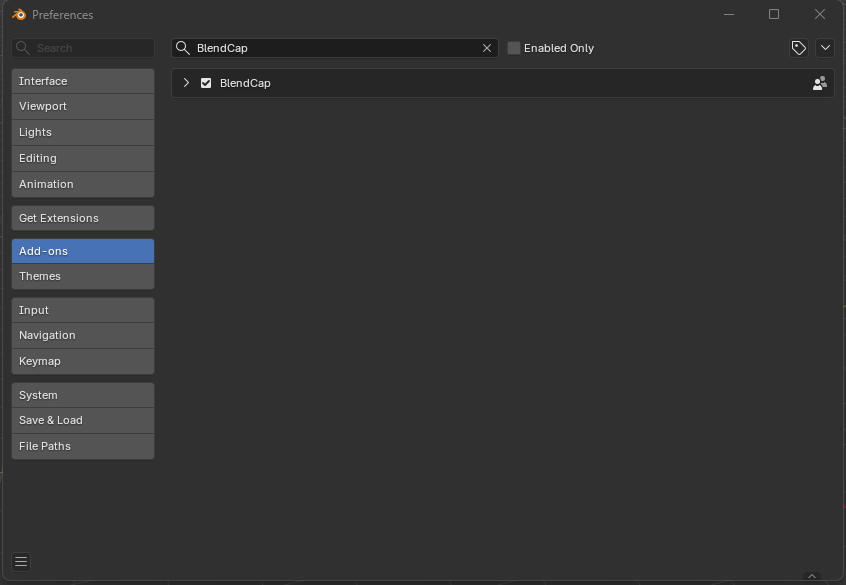
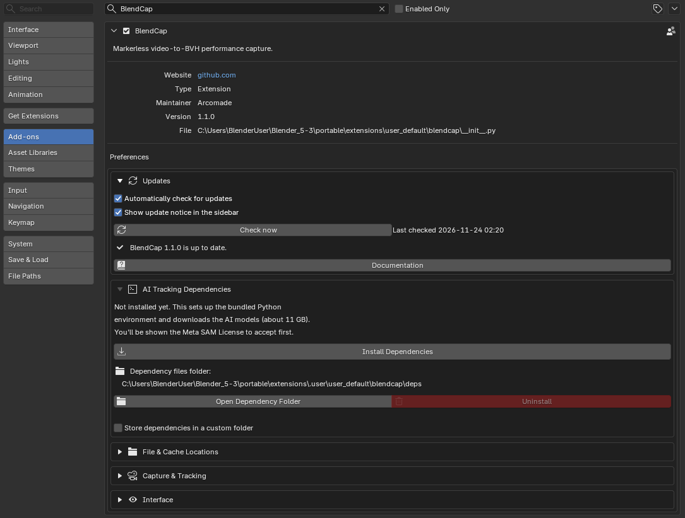
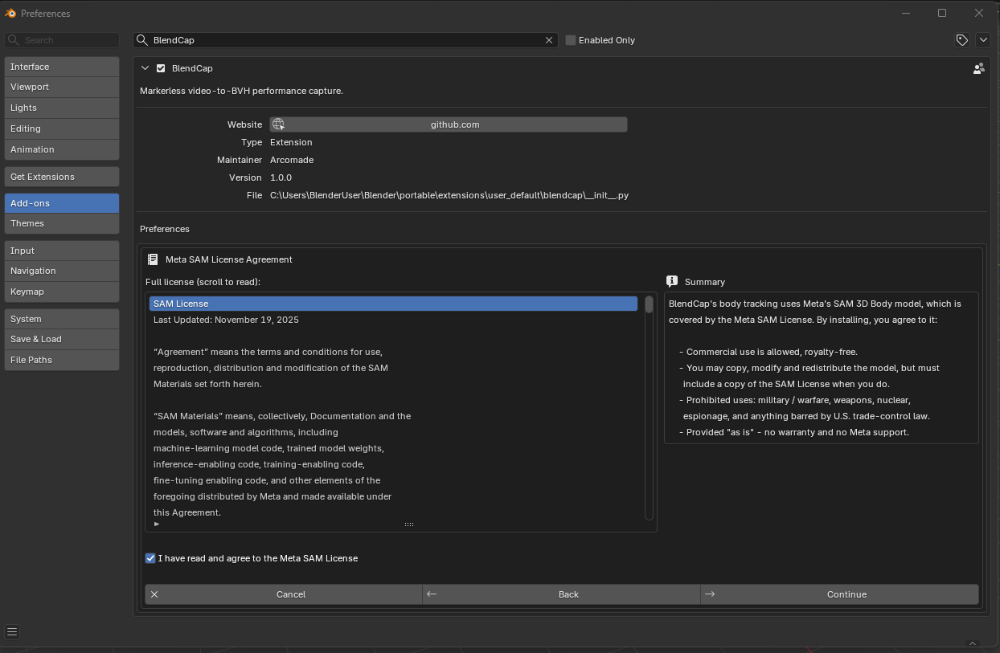
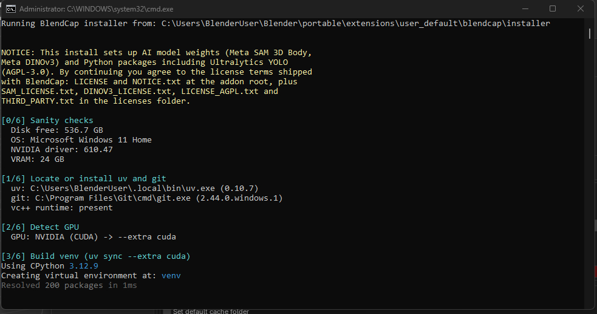

# Installation

---

## Step 1: Install the add-on

1. In Blender, open **Edit ▸ Preferences ▸ Get Extensions** (or **Add-ons**).
2. Use **Install from Disk** and select the BlendCap `.zip` file you downloaded.
3. Enable **BlendCap** in the list if it isn't enabled automatically.

Once enabled, you'll find BlendCap in the **3D Viewport sidebar** (press **N**) under the **BlendCap** tab, as well as in the "**Output**" tab in the **Properties editor**.

---

## Step 2: Install the dependencies

The first time, BlendCap needs to download the models and the libraries that run them (around **11 GB**). This is a one-time setup.

1. If the Preferences window isn't already open, go to **Edit ▸ Preferences ▸ Add-ons**, find **BlendCap**, and expand it. (You can also reach this faster with the **Open Preferences** button in the **Setup** section of BlendCap's sidebar panel.)
2. Click **Install Dependencies**.
   

3. An **install guide** appears, right inside the preferences panel. Read the intro, then review and **accept the model license** (Meta's SAM License), you need to scroll through it and tick the agreement box to continue.
   

4. The next page lists the small system tools BlendCap may install for you if they're missing (a package manager helper, Git, and on Windows the Microsoft Visual C++ runtime). Click **Install** to begin. If any of them need to be installed, your system may ask for permissions in order to install them. The same page has a **Store dependencies in a custom folder** option, in case you'd rather keep the download on a different drive than the one Blender uses.
5. The installer opens a terminal window where you can watch its progress. It will alert you to any errors or extra instructions if needed.
   

6. When it finishes, the terminal window will say "INSTALL COMPLETE" and BlendCap will be ready to capture.

### How long does it take?
Mostly it depends on your internet speed, you're downloading about 11 GB. On a fast connection it's typically several minutes; on a slow one, longer. If the download is interrupted, just run it again, it resumes where it left off rather than starting over.

### If the install is stopped early
If the installer window is closed or stops before it reaches "INSTALL COMPLETE", BlendCap shows a red note in its preferences and at the top of the sidebar panel instead of "Dependencies installed". Click **Reinstall Dependencies** to continue where it stopped, finished downloads are kept.

---

## Platform notes

### Windows
The installer can set up everything a clean machine needs, it will fetch the few system tools it depends on automatically. You don't need Python or any developer tools installed beforehand. If a standard Microsoft component is missing, Windows asks for permissions once in order to install it.

If a tool can't be fetched on your system, the installer tells you exactly which component to install and where to get it.

**Windows 11 and Smart App Control:** if Smart App Control is switched on and enforcing, the installer stops before downloading anything, and BlendCap tells you why. To turn it off, go to Windows Security > App & browser control > Smart App Control settings > Off. This is separate from your antivirus, which will keep running as usual. On Windows builds older than 24H2 with the April 2026 update, it can't be turned back on afterwards without resetting Windows. On newer builds it can. See [Troubleshooting & FAQ](12-troubleshooting-and-faq.md) for more.

### Linux
On Linux the installer opens a visible terminal so you can follow along. Installing some system tools may ask for your password (via `sudo`). Both standard and **Flatpak** Blender are supported.

> **Flatpak Blender, one-time permission.** Because Flatpak runs Blender in a sandbox, BlendCap needs permission to run its installer on the host system. If this permission is missing, the install guide shows the exact command to run, with a **Copy** button. Run it once, restart Blender, and you're set.

---

## Reinstalling and uninstalling

Both live in the BlendCap section of **Add-on Preferences**:

- **Reinstall Dependencies**: re-runs the dependency setup. Useful after a GPU change or if an install was interrupted.
- **Uninstall**: removes the downloaded models and libraries to free up disk space. It asks you to confirm first. (This removes the dependencies, not the add-on itself, disable or remove the add-on through Blender's Add-ons list.)

There's also an **Open Dependency Folder** button if you ever want to see where the dependencies live on disk. They're stored outside the addon itself, so they survive addon updates.

> **Removing the add-on in Blender also removes its dependencies and your custom presets.** Blender deletes an extension's user folder along with the extension, and that's where both are kept by default. If you want to hold on to your custom bone maps and rest poses, click **Export Presets** in [Preferences](11-preferences.md) first. Anything you've moved to a custom folder is not touched.

---

## Where BlendCap keeps its files

The dependencies (the Python environment and the tracking models) and your custom presets are stored outside the add-on's own folder, in Blender's user folder for BlendCap, so updating the add-on can't delete them. Both locations can be changed in [Preferences](11-preferences.md):

- **Store dependencies in a custom folder** (under **AI Tracking Dependencies**) keeps the dependencies on a drive of your choice. **Move Dependency Files** relocates an existing install.
- **Store custom presets in a custom folder** (under **File & Cache Locations**) does the same for your saved bone maps and rest poses.

---

## Updating BlendCap

**From version 1.1.0 onward, BlendCap can update itself.** Once a day, shortly after Blender starts, it checks whether a newer version is out. This needs Blender's online access to be enabled (**Preferences ▸ System ▸ Network**), nothing happens while you're offline. When there's an update, a window offers **Update Now**, **Remind Me Tomorrow** or **Skip This Version**, and a small notice appears at the top of BlendCap's sidebar panel.

**Update Now** installs the new version over the old one, and keeps your dependencies, presets and settings. Restart Blender afterwards to finish. If the update fails because the add-on's folder is open somewhere (a file browser window, a terminal, a code editor), close it and try again.

Both the daily check and the sidebar notice can be turned off under **Updates** in [Preferences](11-preferences.md), which also has a **Check now** button. Apart from this check, BlendCap never goes online on its own.

### Updating from 1.0.5 or older

Versions before 1.1.0 don't have the updater, so updating from 1.0.5 or older to 1.1.0+ will need to be done by hand:

1. Download the new BlendCap `.zip` from the store you bought it from, and unzip it. Open the unzipped folder until you see BlendCap's files (`blender_manifest.toml`, `__init__.py`, the `blendcap` folder and the rest).
2.  In Blender, go to **Edit ▸ Preferences ▸ Add-ons**, expand **BlendCap**, and click **Open Install Folder**. This opens the folder where BlendCap is installed.
3. Select everything inside the unzipped folder and drag it into the install folder. When your system asks, choose to replace the existing files.
4. Restart Blender.

Updating this way keeps your dependencies and your custom bone maps and rest poses, so nothing needs to be reinstalled and any custom presets you've created are safe.

> **Don't use Install from Disk for this update.** In 1.0.5 and older, the dependencies and your custom presets are stored inside the add-on's own folder, and Install from Disk deletes that folder before it installs the new version. You would have to download the dependencies again (about 11 GB), and your custom presets would be gone.

The first time you click in Blender after updating, a window offers to move your dependencies and presets out of the add-on's folder, so future updates can't delete them (see [Troubleshooting & FAQ](12-troubleshooting-and-faq.md)). From then on, BlendCap updates itself without the need for the manual unzipping/replacements.

---

## Verifying the install

The quickest way to confirm everything works:

1. Load a short test video (see [Quick Start](04-quick-start.md)).
2. Run a **Preview**: it should detect the person across the clip in a few seconds.

If Preview finds your subject, your capture path is working. If anything goes wrong, see [Troubleshooting & FAQ](12-troubleshooting-and-faq.md).
