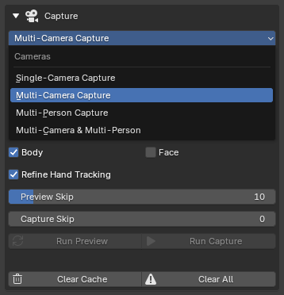
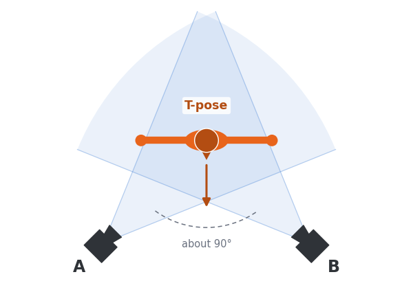
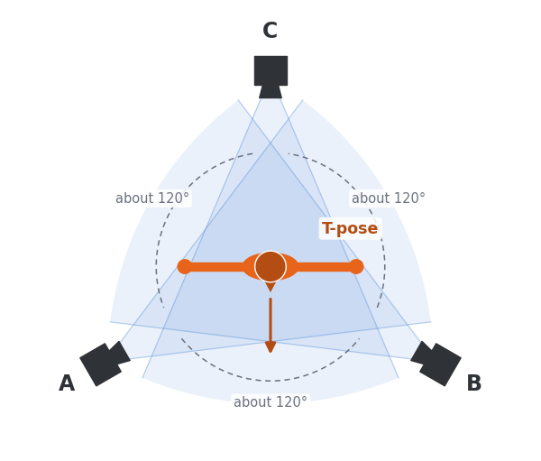
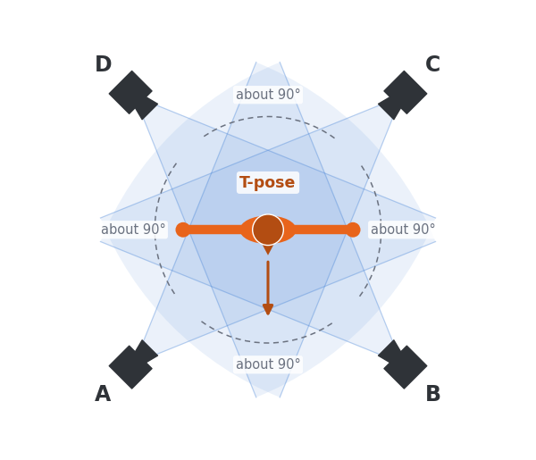
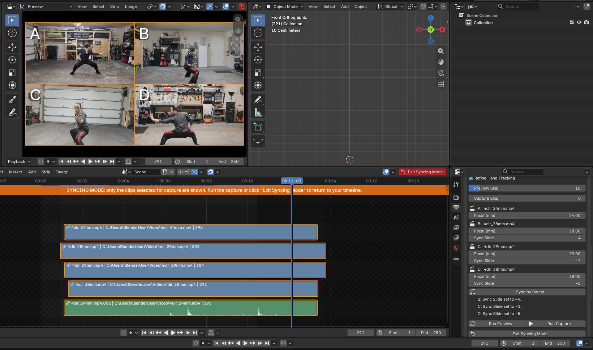
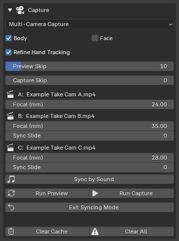
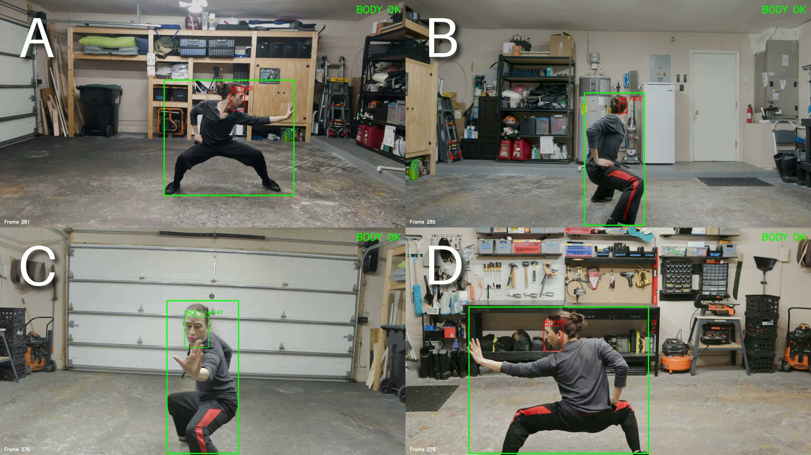
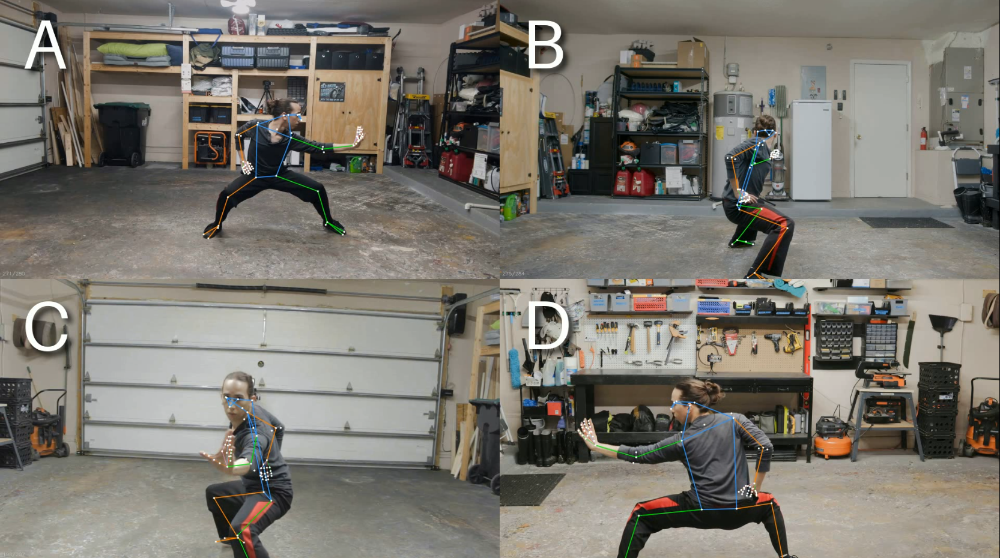

# Multi-Camera Capture

**Multi-Camera Capture** films one performer from up to 4 different angles and combines them into one result. A single camera has to estimate depth, so with more angles the body sits closer to where it really was in the room, the feet hold their place better, and a limb hidden from one camera can still be read from another. You'll find it in the dropdown at the top of the **Capture** section.

> This page covers what's different from a regular capture. Everything on the [Capturing](05-capturing.md) page (Body and Face, the capture options, the cache) still applies here. For shooting advice, see [Filming Tips](13-filming-tips.md).

---

## What you need

- **2 to 4 clips of the same take**, filmed at the same time from different angles.
- **The same frame rate on every camera.** Near-identical rates like 29.97 and 30 fps count as the same, as do 23.976 and 24, or 59.94 and 60, and other similar differences.
- **Each camera's focal length**, as a 35mm-format/full-frame equivalent.
- **A T-pose at the start of the take** (recommended, but not required). Have the performer stand still with their arms out for a moment, in view of every camera. It gives BlendCap a clean, still moment to check the camera positions and the levelling against, which makes results a little more consistent, especially on short takes.

**Recommended camera setups**, seen from above. The orange figure is the performer in the T-pose, and the arrow shows which way they face: diagonally between two cameras, not straight at one.

**2 cameras**, about 90° apart:

**3 cameras**, spaced evenly around the performer, about 120° apart:

**4 cameras**, spaced evenly around the performer, each about 90° from the next:

---
## Step 1: Select your clips

Set the **Video Source** to **Video Editor Strip** and place your clips in the Sequencer (see "Working in the Sequencer" on the [Capturing](05-capturing.md) page). Then set the **Capture** dropdown to **Multi-Camera Capture**, and select 2 to 4 video strips with a box select or shift-click.

The cameras are lettered by where their strips sit on the timeline: **camera A** is the strip on the highest channel, then B, C and D going down. Strips that share a channel are lettered left to right.

> Camera A is the reference: the other cameras are lined up against it, and the finished armature is named after its clip.

---

## Step 2: Sync the clips

Click **Sync Clips**. BlendCap enters **syncing mode**: the Sequencer shows only the clips you're syncing, stacked on top of each other, and the preview shows every camera side by side with its letter. The rest of your timeline is hidden while you sync, and it comes back when you leave syncing mode.

Each camera now has its own row in the **Capture** section, with a **Focal (mm)** field and, for cameras B to D, a **Sync Slide**. There are three ways to line the clips up:

- **Sync by Sound** lines cameras B to D up with camera A by comparing their audio, and sets their Sync Slides for you. Every camera needs to have recorded sound in the same room, and distinct sounds like a clap or speech work best. A silent room, a constant hum, or music with nothing but a steady beat won't give it enough to go on. If it can't be sure about a clip, it leaves that clip where it is and tells you which one.
- **Sync in the Timeline** by grabbing the video strips with the move tool, and dragging them into position.
- **Sync Slide** slides a camera's footage in time manually to line it up with camera A, one frame at a time. Use it on its own, or to touch up what Sync by Sound found.

While you sync you only hear one camera (camera A, or the next one down if A has no sound). Every other sound in the timeline is muted until you leave syncing mode.

> The sync doesn't have to be perfect. When you run the capture, BlendCap measures what's left of the offset from the footage itself and corrects up to 5 frames of it. Clips further apart than that get a warning instead, so line them up to within a few frames.

To leave syncing mode without capturing, click **Exit Syncing Mode** (the red button in the Sequencer's header, or the one in the **Capture** section). Your clips stay aligned. They're left as one block, with the sound you were hearing directly under them, and the other cameras' sound strips are removed. Pressing **Tab** in the Sequencer or switching to another capture mode leaves syncing mode as well.

---

## Step 3: Enter the focal lengths

Type each camera's focal length into its **Focal (mm)** field, as a **35mm-format/full-frame equivalent**. An empty field shows in red, and the capture won't start until they're all filled in.

> **Working out the 35mm equivalent:** on a full-frame camera, use the number on the lens. On a smaller sensor, multiply the lens value by the camera's crop factor, for example an 18mm lens on a 1.6× crop camera is 28.8mm (see [Capturing](05-capturing.md) for more). On a phone, look up the lens you actually filmed with, the front camera is not the same as the main one.

---

## Step 4: Run a Preview (optional)

**Run Preview** does the same job it does for a single clip (see [Capturing](05-capturing.md)), but checks every camera, and shows them side by side in one preview strip, each with its letter. With **Face** enabled, each camera also marks the face where it can see it. A camera that's behind the performer will show **NO FACE**, and that's fine. The preview doesn't need the focal lengths.

With the preview strip selected, you can run the preview again or go straight to **Run Capture**, the focal length fields stay available next to the preview strip. If you want to change the sync after a preview, click **Revert to Original Clips** first.

---

## Step 5: Run the capture

Click **Run Capture**. BlendCap captures each camera in turn, over the frames the clips share, so expect it to take roughly as many times longer as you have cameras.

When it finishes, your clips are replaced by **one strip** that shows every camera side by side, each with its own tracked skeleton and letter, so you can check them all at a glance. The sound strip you heard while syncing stays, right under it. The other cameras' sound strips are removed.

- **Revert to Original Clips** brings all of your clips back, still synced.
- Running the capture again re-uses the cameras that are already captured, the same way the cache works for a single clip.
- If a capture with the same name already exists, BlendCap asks whether you want to **Capture as New Take** (the existing capture is kept) or **Overwrite Existing**.

---

## Generating the BVH

Select the multi-camera strip and click **Generate/Reload BVH** like you would for any other capture (see [BVH Generation and Post-Processing](08-bvh-generation-and-post-processing.md)). The armature is named after camera A's clip, with the number of cameras in front of the letters, so a four-camera take of `A0314` becomes `A0314_4cBHR`.

A few things behave differently on a multi-camera take:

- **The result is levelled automatically**, from the floor the performer moves across, or from how they stand when the take is short. A short take where the performer never stands still on their feet (or one where they sit or lie down throughout) can still come in tilted, and **Camera Angle Offset** straightens it the same way as always.
- **Jumps and deep squats keep the height the cameras measured**, instead of being rebuilt from the foot contacts.
- **Rebuild Finger Motion** reads the fingers from every camera, so it takes longer than it does on a single clip.
- **Add Camera** gets a **Camera View** dropdown, so you can choose which of your cameras the scene camera matches.
- **The face** comes from one camera at a time, see [Face Capture](06-face-capture.md).

---
## Capturing from File Path

If your clips are **already synced** and were **filmed on identical cameras**, you can skip the Sequencer. Leave the **Video Source** on **File Path**, set the **Capture** dropdown to **Multi-Camera Capture**, click **Select Clips** and pick 2 to 4 files, then enter the one focal length they share. There's no syncing step, and the result shows on a plane in the viewport like any other File Path capture.

BlendCap warns you if the clips have different lengths or resolutions, and won't run them if their frame rates differ. For anything that isn't already synced and matched, use **Video Editor Strip** instead.

---

## Tips

- **Camera placement matters more than camera count.** Cameras around 90° apart give BlendCap the most to work with. Two cameras facing each other from opposite sides of the performer see nearly the same thing.
- **You don't need four cameras.** The second camera is the big step up that offers the most improvement from single-camera captures. A third camera still helps, mostly in the wrists and ankles. A fourth adds little on clean footage, but covers you when one of the others is blocked or badly placed.
- For more on shooting, see [Filming Tips](13-filming-tips.md).
