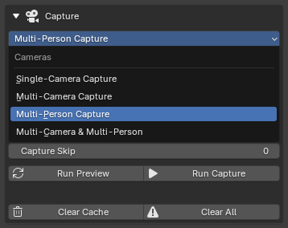
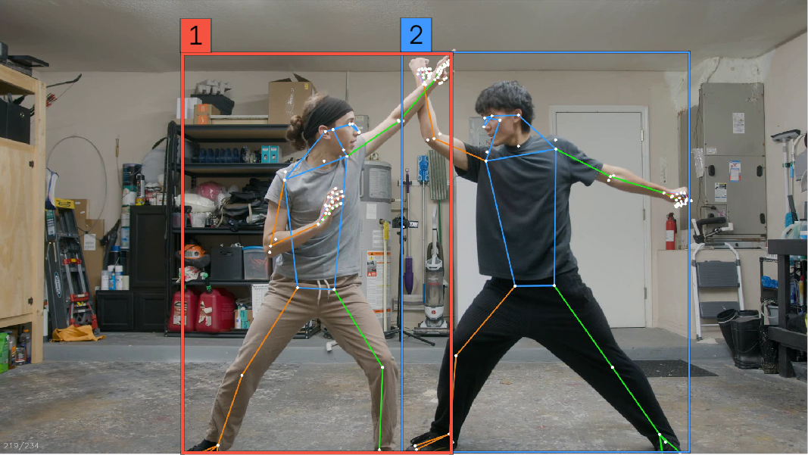
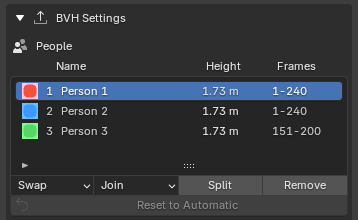
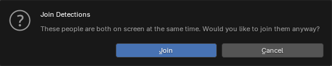
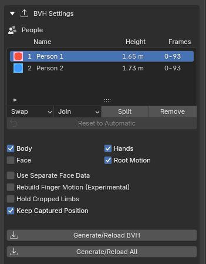
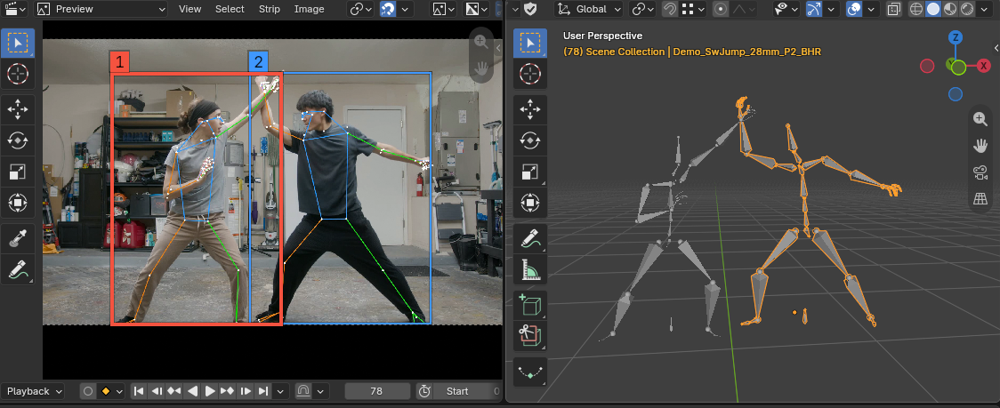

# Multi-Person Capture

**Multi-Person Capture** follows everybody in a single video and keeps each person's performance separate, so one clip can give you an armature for every performer. You'll find it in the dropdown at the top of the **Capture** section.

> This page covers what's different from a regular capture. Everything on the [Capturing](05-capturing.md) page still applies here. For shooting advice, see [Filming Tips](13-filming-tips.md).

---

## Running the capture

Choose your video and click **Run Capture**, the same as any other capture. Two things are different in this mode:

- **Face-only capture is not supported.** The face is tracked once per person, and BlendCap finds each face from that person's tracked body. With **Body** turned off, the **Face** checkbox and **Run Capture** are greyed out.
- **It takes longer.** Capture time grows with the number of people in the picture. On a modern NVIDIA card, expect roughly 0.3 seconds per frame for one person, 0.4 for two, 0.55 for three and 0.7 for four. Shots where people keep getting lost behind each other take longer still. **Capture Skip** and turning off **Refine Hand Tracking** both help speed things up, at the cost of accuracy.

**Run Preview** draws a box around everybody it finds and shows how many people it sees on each checked frame. With **Face** enabled it also marks a face on each person, or **NO FACE** where it can't find one. The preview doesn't number anyone, who is who is only worked out by the full capture.

> A **NO FACE** in the preview isn't the final word. The capture looks for each face from the tracked head, which is more thorough than the preview's quick check.

---
## Reading the result

The overlay shows every tracked skeleton, and BlendCap draws a numbered, colored box around each person so you can see who is who.

- **Each person has a number and color.** People are numbered in the order they're detected, and left to right when they're in the shot from the same frame.
- **A thicker box** is the person selected in the People list (see below).
- **A dashed box** means that frame was filled in: the detector lost the person, and BlendCap either looked again where they were or bridged a short gap. If a person's motion goes wrong somewhere, a dashed stretch is the first place to look.
- **A "?" after the number** means the capture wasn't sure who is who on that frame.

A few things to know about how people are followed:

- **Somebody who walks in late** holds their first pose from the start of the clip, so everybody's animation begins on the same frame and stays lined up.
- **Somebody lost for a moment** is picked up again when they reappear close to where they were. If they're gone for too long they come back as a new person, which you can fix with **Join** (see below).
- **A face has to be reasonably large and turned toward the camera** to be found at all. Anyone whose face isn't found is simply exported without one.

---

## The People list

Whenever the selected capture is a multi-person one, a **People** list appears at the top of **BVH Settings**. Each row shows a person's color, their number, a name (double-click to rename it), their height, and the frames they appear in.

The selected row is the person that **Generate/Reload BVH** exports.

### Fixing mistakes

Busy shots sometimes confuse the tracking: two people trade numbers when they cross, or one person is picked up twice. The four buttons under the list fix this without running the capture again:

- **Swap** exchanges the selected person with another one, from the playhead to the end of the clip. Use it when two people trade numbers partway through: put the playhead where it happens, then swap them.
- **Join** makes the selected person and another one the same person. Use it when someone comes back with a new number after being hidden. The lower number is the one that's kept.
- **Split** turns the selected person into a new person from the playhead to the end of the clip.
- **Remove** takes a person out of the list, for false detections or someone in the background you don't need.

If you **Join** two people who are on screen at the same time (one performer detected twice), BlendCap asks before going ahead. On the frames they share, the selected person's motion is the one that's kept, so select the one that looks right first, then join it with the other.

- **Reset to Automatic** drops every correction and goes back to what the capture found. Names and heights you typed are kept.
- **Ctrl+Z** undoes a correction like anything else in Blender.

> Corrections are saved with the capture itself (in its cache folder), not in your `.blend` file, so they're still there if you close without saving. Capturing the same clip again discards them, since they were made against the old result.

### Setting heights

A single camera can't tell how tall anybody is, so everybody comes out at the same height by default (1.73m). To set a performer's real height, double-click their **Height** in the list and type it, or drag the value.

- The armature is made that tall, and the person is moved nearer to or further from the camera to match. With **Keep Captured Position** enabled, that changes the distance between people too.
- Typing **0** will automatically go back to the default 1.73m.
- Heights are saved with the capture, like names, and are shown in your scene's units.
- Click **Generate/Reload BVH** again after changing a height.

>Tip: Blender converts units for you in any field that holds a measurement. So even if your scene is set to meters, you can type "5ft 8in" into Height and get the correct value in meters automatically. If you'd rather just work in feet or inches, set the Unit System to Imperial under Scene Properties > Units.

---

## Generating the armatures

- **Generate/Reload BVH** exports the person selected in the People list. The armature is named after the clip and the person's number, like `walk_P2_BHR`.
- **Generate/Reload All**, just below it, goes through everybody in the list and imports each one into the scene. **Cancel** stops it between two people.
- **Keep Captured Position** places each armature where that person stood in the footage, measured from the 3D cursor, so everyone in the capture lines up the way they did on set. With it off, every armature starts on the 3D cursor.

From there each person's armature is a regular BlendCap armature: the post-processing controls, **Bake Settings to BVH**, **Rebuild Finger Motion**, the BVH Library and retargeting all work the same way (see [BVH Generation and Post-Processing](08-bvh-generation-and-post-processing.md)).

> **Add Camera** needs one of the armatures selected in this mode. One camera is enough for the whole group, and with **Keep Captured Position** enabled it sits right over the 3D cursor.

---

## Tip

- **Keep everybody fully in frame.** People who cross in front of each other or leave the shot are where the numbering goes wrong. Need more accuracy, or will your shot have people who block each other a lot? See [Multi-Camera & Multi-Person](05c-multi-camera-and-multi-person.md).
