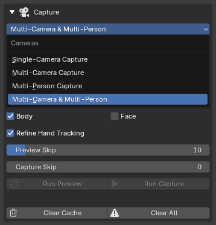
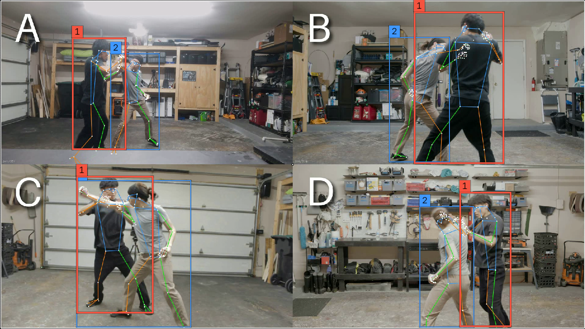
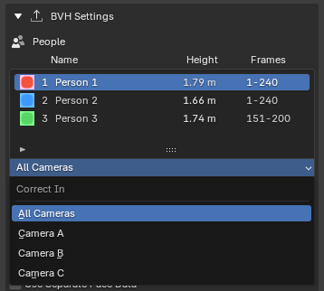

# Multi-Camera & Multi-Person

**Multi-Camera & Multi-Person** captures multiple performers from up to 4 different angles. It works like the two modes it combines, so read [Multi-Camera Capture](05a-multi-camera-capture.md) and [Multi-Person Capture](05b-multi-person-capture.md) first. This page only covers what's different when you use both together.

---

## Before you film

**Everybody should start the take in a T-pose** when possible, standing apart from each other with room for their arms, and fully visible to every camera. It isn't required, but it gives BlendCap a clean moment where every camera sees everybody separately, which makes lining the cameras up and matching the people between them a little more reliable.

---

## Running the capture

The steps are the same as [Multi-Camera Capture](05a-multi-camera-capture.md): select your clips, **Sync Clips**, enter a focal length for each camera, then **Run Preview** or **Run Capture**.

BlendCap captures every camera for everybody it sees, then matches the people across the cameras. Capture time grows with both the number of cameras and the number of people, so this is the slowest mode by a wide margin.

---

## Reading the result

You get one strip with every camera side by side, the same as a multi-camera capture, and every camera shows the numbered boxes from a multi-person capture. The same person has the same number and color in every camera, so a camera that disagrees with the others is easy to spot.

A camera where the performers block each other, like a side view of two people facing one another, will lose or double people on its own. That's expected, and the other cameras cover for it.

---

## The People list

The People list works the same way as in [Multi-Person Capture](05b-multi-person-capture.md), with one addition: a dropdown above the four buttons that sets which cameras they correct. It starts on **All Cameras**, and you can switch it to a single camera when only that one got something wrong.

### Heights

With more than one camera, BlendCap measures how tall the performers are compared to each other, and the **Height** column fills in by itself with an estimate for everybody. What the cameras can't measure is the size of the whole take, so the estimates assume the performers average 1.73m.

If you know one performer's real height, double-click their **Height** and type it. The whole take is then rescaled to match: the other performers, and the distances between everybody, follow by the proportions the cameras measured. That's why heights can't be set one by one in this mode. The last height you type is the one that counts, and typing **0** goes back to the default estimates.

- After a correction (**Swap**, **Join**, **Split**, **Remove** or **Reset to Automatic**) the column shows 1.73m for a few seconds while the performers are measured again.
- If the cameras couldn't be lined up from the people in the take, the column shows 1.73m and is greyed out.
- Click **Generate/Reload BVH** again after changing a height.

---

## Generating the armatures

**Generate/Reload BVH**, **Generate/Reload All** and **Keep Captured Position** work as described on the [Multi-Person Capture](05b-multi-person-capture.md) page. Armatures are named after camera A's clip, the person and the camera count, for example: `Shot23_P2_4cBHR`.

- **The cameras are merged per person, when that person's armature is generated.** The first time you generate each person takes a few seconds longer because of it. Generating the same person again skips that step, unless a correction or a height typed in the People list changed them.
- **Each performer comes out at their own size.** A taller and a shorter performer give a taller and a shorter armature, as the cameras measured them (see **Heights** above).
- **Everybody shares one flat floor**, so the armatures stand level with each other. A performer who stood on something raised, like a platform, still comes out at floor level, so move their armature up by hand.

---

## Tips

- **A camera that keeps everybody in sight for the whole take is worth more than an extra angle** where people hide each other. If you're adding a third camera, that's the one to add.
- **You don't always need 4 cameras.** Just like single-person multi-camera captures, the second camera offers the most improvement. Three cameras are the sweet spot for multi-person captures as far as covering all your bases goes. A fourth is good to have as a safety, or if the performers will often step out of frame on the other cameras.
- **Avoid pointing a camera along the line between two performers**, it will see one hiding behind the other.
- **Close contact (grappling, hugging) is the hardest case.** More cameras help, and so does checking the People list carefully afterwards.
