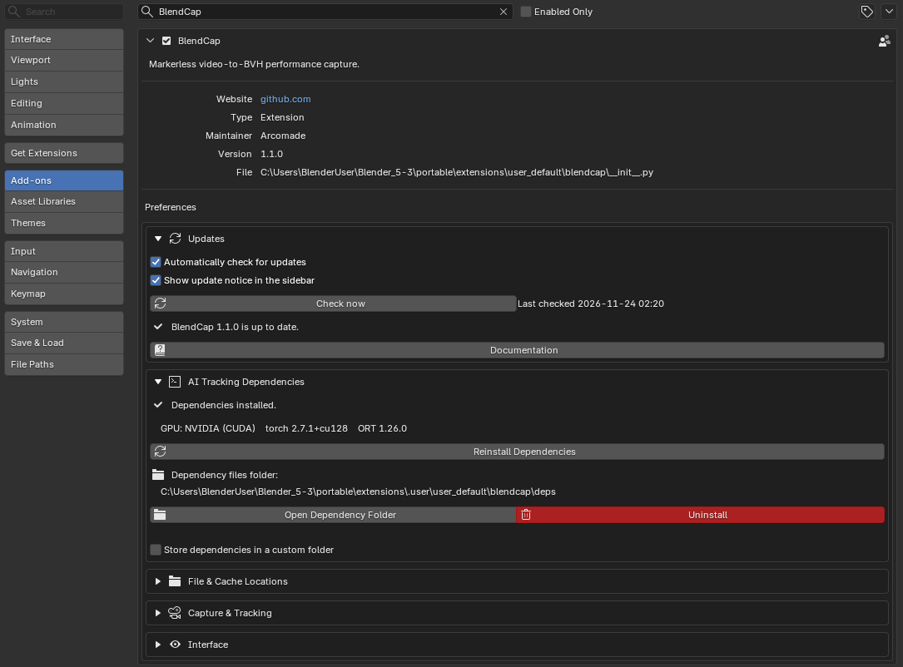
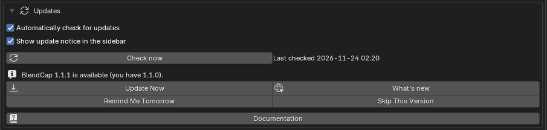

# Preferences

BlendCap's preferences can be found in **Edit ▸ Preferences ▸ Add-ons ▸ BlendCap**. They apply to your whole Blender install (not per-project), so you set them once. The quickest way there is the **Open Preferences** button in the Setup section of BlendCap's sidebar panel.

The preferences are grouped into five sections. Each one folds open and closed from the arrow in its header.

---

## Updates

BlendCap can check for new versions and install them for you (see [Installation](03-installation.md)).

| Control                                        | What it does                                                                                                                                                                              |
| ---------------------------------------------- | ----------------------------------------------------------------------------------------------------------------------------------------------------------------------------------------- |
| **Automatically check for updates**            | Once a day, shortly after Blender starts, looks for a newer BlendCap release and offers to install it. Needs Blender's online access (**Preferences ▸ System ▸ Network**). On by default. |
| **Show update notice in the sidebar**          | Shows a small notice at the top of BlendCap's sidebar panel while an update is waiting. On by default.                                                                                    |
| **Check now**                                  | Checks for an update right away. The time of the last check is shown next to it.                                                                                                          |
| **Update Now**                                 | Shows when an update is available. Installs it over your current version and keeps your dependencies, presets and settings. Restart Blender afterwards.                                   |
| **What's new**                                 | Opens the new version's list of changes.                                                                                                                                                  |
| **Remind Me Tomorrow** / **Skip This Version** | Put the update off for a day, or ignore this version until the next one is released.                                                                                                      |
| **Documentation**                              | Opens this documentation online.                                                                                                                                                          |

If **Update Now** is greyed out, a note below it says why and what to do. Usually the new version needs a newer installer (download the full package from your store page and use **Install from Disk**), or some of your files are still stored inside the add-on's folder and need to be moved first. If you installed BlendCap through a store's own repository in **Get Extensions**, updates come through there instead, and these controls are switched off.

---

## AI Tracking Dependencies

Manage the models and libraries BlendCap needs. When everything is installed, this section confirms it and lists what was detected (your GPU and the installed library versions), for reference and support questions.

| Control                                                            | What it does                                                                                                                                                                                                                                                                                                                                                                                |
| ------------------------------------------------------------------ | ------------------------------------------------------------------------------------------------------------------------------------------------------------------------------------------------------------------------------------------------------------------------------------------------------------------------------------------------------------------------------------------- |
| **Install Dependencies**                                           | Runs the one-time setup (see [Installation](03-installation.md)). Shows as **Reinstall Dependencies** once they're installed, re-run it after a GPU change or an interrupted install. When an install didn't finish, a red note says so here, and **Reinstall Dependencies** continues where it stopped.                                                                                    |
| **Open Dependency Folder**                                         | Opens the folder where the installed dependencies live on disk (the path is shown above the button). The addon's own folder has an **Open Addon Folder** button under **File & Cache Locations**.                                                                                                                                                                                           |
| **Uninstall**                                                      | Removes the bundled Python environment and downloaded AI models to free disk space (several GB). A confirmation appears first; Blender may freeze briefly while files are removed, and you'll need to reinstall before capturing again.                                                                                                                                                     |
| **Store dependencies in a custom folder**                          | Keeps the dependency files (about 11 GB) in a folder you choose, for example on a bigger drive. New installs go there, and **Move Dependency Files** relocates an existing install, with a progress bar and a **Cancel Move** button. Unticking the box offers to move them back. BlendCap warns you about slow or removable drives, since every capture loads the models from that folder. |
| **Don't show the startup warning about files in the addon folder** | Only matters if you updated from 1.0.5 or older and chose not to move your files. It stops the reminder window at startup. The files stay where they are, and an add-on update can still delete them.                                                                                                                                                                                       |

This section is also where BlendCap tells you when something needs attention: dependencies that were built for an earlier version and need a rebuild, a custom dependency folder that can't be found (reconnect the drive, don't reinstall), or Windows Smart App Control blocking the capture engine. See [Troubleshooting & FAQ](12-troubleshooting-and-faq.md).

---

## File & Cache Locations

Choose where BlendCap stores its data (covered in [BVH Library & Cache](10-bvh-library-and-cache.md)).

| Control                                     | What it does                                                                                                                                                                                                                                              |
| ------------------------------------------- | --------------------------------------------------------------------------------------------------------------------------------------------------------------------------------------------------------------------------------------------------------- |
| **Set default cache folder**                | Save tracking data to a folder you choose instead of the temporary folder, so captures made in unsaved projects survive closing Blender. Saved projects still keep their cache next to the `.blend` file unless you also tick **Always use this folder**. |
| **Use a custom BVH library folder**         | Read and save the BVH library from a folder you choose. Point several projects at one shared folder to reuse takes across them.                                                                                                                           |
| **Store custom presets in a custom folder** | Keeps your saved bone maps and rest poses in a "BlendCap Presets" folder inside a location you choose. They move there the moment you pick it, and move back when you untick it.                                                                          |
| **Open Preset Folder**                      | Opens the folder your custom presets are in (the path is shown above the button). It holds a `retarget_maps` folder and a `rest_pose_presets` folder, so preset files can also be copied in by hand.                                                      |
| **Export Presets** / **Import Presets**     | Saves all of your custom bone maps and rest poses into one zip file, or adds the presets from such a file. Importing keeps the presets you already have, unless you choose to replace them.                                                               |
| **Open Addon Folder**                       | Opens the folder the add-on itself is installed in.                                                                                                                                                                                                       |

Changing a location doesn't move existing data, new captures use the new location. (Custom presets and dependencies are the exception, see their rows.)

---

## Capture & Tracking

Settings that affect how captures run.

### Capture Backend

Which hardware runs the body capture. **Automatic** suits almost everyone, it uses whatever the installer detected, and a line below the dropdown shows what that was. The rest are manual overrides (see [System Requirements](02-system-requirements.md) for supported hardware).

| Backend                                               | Use it when                                                                                                                                                                                                                                                                                                                                                              |
| ----------------------------------------------------- | ------------------------------------------------------------------------------------------------------------------------------------------------------------------------------------------------------------------------------------------------------------------------------------------------------------------------------------------------------------------------ |
| **Automatic (use what was detected at installation)** | Recommended. If you've changed GPUs since installing, run **Reinstall Dependencies** so detection is refreshed.                                                                                                                                                                                                                                                          |
| **NVIDIA - CUDA**                                     | Force the NVIDIA engine: the fastest, most accurate, fully supported path.                                                                                                                                                                                                                                                                                               |
| **Non-NVIDIA - DirectML / ONNX (experimental)**       | Force the DirectML path for AMD/Intel GPUs. Slower, slightly less accurate, and experimental.                                                                                                                                                                                                                                                                            |
| **CPU Only (no GPU - very slow)**                     | Run capture entirely on the CPU. Works on almost any machine and avoids GPU out-of-memory crashes, but expect minutes per frame. If the fast-CPU component isn't already installed (for example, after switching from an NVIDIA install), the first CPU capture downloads it once (~1.7 GB) when online; without it, capture still completes on an even slower fallback. |

### Other capture settings

| Control                              | What it does                                                                                                                                                                                                                                                                                                                                                                                                                                                                                                                  |
| ------------------------------------ | ----------------------------------------------------------------------------------------------------------------------------------------------------------------------------------------------------------------------------------------------------------------------------------------------------------------------------------------------------------------------------------------------------------------------------------------------------------------------------------------------------------------------------- |
| **Refine Hand Tracking Default**     | Where the **Refine Hand Tracking** checkbox in the Capture section starts each time you open Blender (the checkbox itself can be changed freely during a session). **Automatic** (default) starts enabled on NVIDIA and disabled on non-NVIDIA/CPU, where the extra pass is slow; Choose **On by default** for best hands everywhere; **Off by default** for speed. Hands are still captured either way, this pass only adds polish, and whether hands appear in the armature at all is the **Hands** toggle in BVH Settings. |
| **Show Footage in BlendCap Cameras** | Shows the source video as the background of cameras added with **Add Camera** (see [BVH Generation and Post-Processing](08-bvh-generation-and-post-processing.md)). On by default.                                                                                                                                                                                                                                                                                                                                            |
| **Default Source**                   | Which video source new projects start on: **File Path** or **Video Editor Strip**. Set it to Video Editor Strip if you usually capture from the timeline.                                                                                                                                                                                                                                                                                                                                                                     |
| **Disable playhead auto-snap**       | Keep the timeline playhead where it is when a capture starts, rather than jumping to the start of the selected clip.                                                                                                                                                                                                                                                                                                                                                                                                          |

> **Refine Hand Tracking is not Rebuild Finger Motion.** Refine Hand Tracking sharpens the hand *capture* itself, it's an extra pass at tracking time. **Rebuild Finger Motion** (in BVH Settings) is a separate control that reshapes the fingers afterward, to retain as much detail as possible when the BVH is generated. See [Hand & Finger Tracking](07-hand-tracking.md).

### When video is added to the sequencer

Blender changes a few project settings when you drop a video into the Video Sequencer. These four options stop it from doing that, and all four are on by default:

| Control                                             | What it does                                                                                                                                                                                                              |
| --------------------------------------------------- | ------------------------------------------------------------------------------------------------------------------------------------------------------------------------------------------------------------------------- |
| **Keep the project's view transform**               | Blender normally switches the view transform to Standard when a clip is added. This keeps your project's own setting (AgX, Filmic), and sets the new clip up so it still displays the way it should.                      |
| **Keep the project's frame rate**                   | Blender normally sets the project's frame rate to the clip's. This keeps the project's frame rate. The clip still plays at normal speed, and capturing a clip with a different frame rate offers the usual conversion.    |
| **Turn off Sequencer rendering**                    | Blender's **Output ▸ Post Processing ▸ Sequencer** option makes renders show your video strips instead of your scene. This turns it off when a clip is added, or when the Video Source is switched to Video Editor Strip. |
| **Only while the BlendCap workspace tab is active** | Limits the three options above to BlendCap's **Performance Capture** workspace, rather than all video editing workspaces. Untick it to have them apply in any workspace with a Sequencer.                                 |

---

## Interface

Tailor the BlendCap panels to your taste. Both toggles apply instantly.

| Control                               | What it does                                                                                                                                                                         |
| ------------------------------------- | ------------------------------------------------------------------------------------------------------------------------------------------------------------------------------------ |
| **Hide the Setup section**            | Hides the Setup box at the top of the sidebar panel once you're past first-time setup, and if you don't need the **Open Workspace** button.                                          |
| **Hide the "Clear All" cache button** | Hides **Clear All** so the whole capture cache can't be wiped by accident, **Clear Cache** (current clip only) stays available. Useful when several projects share one cache folder. |

This section also walks you through keeping the **BlendCap workspace** available in every new project: open the workspace once from the sidebar's Setup section, then use **File ▸ Defaults ▸ Save Startup File**. It's best done from a fresh project, since the startup file saves your entire scene. The section shows where the startup file lives (with an **Open Folder** button), and deleting that file reverts Blender to its default startup.